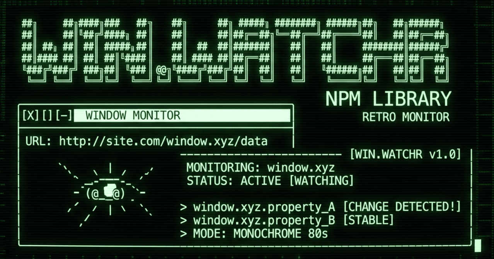

# windotwatchr



[](https://github.com/juanpprieto/windotwatchr/actions/workflows/ci.yml)
[](https://www.npmjs.com/package/windotwatchr)
[](https://bundlephobia.com/package/windotwatchr)
[](https://github.com/juanpprieto/windotwatchr/blob/main/LICENSE)

> Detect readiness of `window.*` globals and nested APIs with assignment interception and optional polling.

**Development version:** this branch documents the proposed 0.3.0 release. The
published npm version is currently 0.2.0; `npm install windotwatchr` installs that
version. Follow [the setup instructions](CONTRIBUTING.md#setup) and build locally
to evaluate the behavior described here. Final
versioning, validation and publication remain pending.

- **Zero dependencies.** React is an optional peer dep.
- **Proxy-based.** Intercepts property assignment via `Object.defineProperty` traps and ES Proxies. Queues a callback for the next microtask when your readiness predicate passes.
- **Typed.** Written in TypeScript. Generics flow through to your callback or hook result.

```
npm install windotwatchr
```

The package is ESM-only. Import from `windotwatchr` or `windotwatchr/react` in an ESM application or browser bundler. Bun powers repository tooling; the published library uses standard browser APIs and needs no Bun runtime.

### AI Agent Skill

Install the skill for API usage, detection limits and contributor instructions:

```bash
# Agents supported by the skills CLI
npx skills add juanpprieto/windotwatchr -s windotwatchr-expert

# Claude Code plugin marketplace
/plugin marketplace add juanpprieto/windotwatchr
/plugin install windotwatchr-expert@windotwatchr
```

## Live Demos

- [Next.js showcase](https://juanpprieto.github.io/windotwatchr/nextjs/)
- [Vite + React showcase](https://juanpprieto.github.io/windotwatchr/vite-react/)

## The Problem

Third-party scripts attach themselves to `window` at unpredictable times. Many provide no ready callback, making it hard to coordinate dependent UX flows, defer analytics events until an SDK is initialized, or render widgets that depend on deeply nested APIs. The standard workaround is a `setTimeout` loop:

```js
const check = () => {
  if (window.AfterPay) {
    AfterPay.initialize({ countryCode: 'US' });
  } else {
    setTimeout(check, 100); // poll until it exists
  }
};
check();
```

Polling observes snapshots and adds delay. Interception can detect writes immediately, while polling remains necessary for changes made through retained raw references, closure getters, and dependencies outside the watched path.

Prefer an SDK's documented ready callback or promise when available. The payment names in these examples illustrate integration patterns; they are not verified vendor compatibility claims. Script loading only means the resource loaded. A usable API may appear later, and an existing stub may still be unusable. windotwatchr only knows what the watched value and your predicate establish.

The same problem applies beyond ecommerce: analytics coordination (firing events only after a tracker is fully initialized), A/B testing tools that gate rendering on experiment configs, and any script that builds its API surface incrementally across multiple async stages.

## Usage

### Callback

```ts
import { watchWindot } from 'windotwatchr';

const dispose = watchWindot<typeof AfterPay>('AfterPay', (ap) => {
  ap.initialize({ countryCode: 'US' });
});

// Stop watching:
dispose();
```

### Promise

```ts
import { waitForWindot } from 'windotwatchr';

const ap = await waitForWindot<typeof AfterPay>('AfterPay', {
  timeout: 10_000,
});
```

### React Hook

```tsx
import { useWatchWindot } from 'windotwatchr/react';

function Checkout() {
  const { value: afterPay, status, error } = useWatchWindot<typeof AfterPay>('AfterPay', {
    timeout: 10_000,
  });

  if (status === 'error')   return <p>Error: {error?.message}</p>;
  if (status === 'timeout') return <p>AfterPay took too long.</p>;
  if (!afterPay)             return <p>Loading...</p>;

  return <button onClick={() => afterPay.initialize({ countryCode: 'US' })}>Pay later</button>;
}
```

### Nested Paths

Dot-notation follows string property names, including inherited properties. The engine installs Proxy traps at each level and resolves the moment the leaf value is assigned:

```ts
watchWindot('acmePayments.ui.components', (components) => {
  // Fires when window.acmePayments.ui.components is set,
  // even if acmePayments, ui, and components are assigned
  // at different times.
});
```

### Custom Readiness

By default, a value is "ready" when it is not `null` or `undefined`. Override this when an SDK creates a stub object before it is fully initialized:

```ts
watchWindot('acmePx.loaded', (loaded) => {
  console.log('Pixel SDK ready');
}, {
  ready: (value) => value === true,
});
```

### Abort

Tie a watcher to an `AbortController`. Aborting rejects `waitForWindot` with the signal's reason:

```ts
const controller = new AbortController();

waitForWindot('AfterPay', { signal: controller.signal })
  .catch((reason: unknown) => console.log(reason)); // Preserves the exact reason

controller.abort(); // or: controller.abort(new Error('navigated away'))
```

After timeout and configured retries, `waitForWindot` rejects with a `DOMException` named `TimeoutError`, or an `Error` with that name when `DOMException` is unavailable. Abort preserves `signal.reason` exactly, including null, false, zero and objects; older signals without a reason use `AbortError`. Cancellable manual timers and listeners provide these outcomes without requiring `AbortSignal.timeout()` or `AbortSignal.any()`.

### Auto-dispose with `using`

A `using` scope must remain open until readiness. This example awaits a callback before leaving the scope:

```ts
import { watchWindot } from 'windotwatchr';

async function useSDKInScope() {
  let signalReady!: () => void;
  const ready = new Promise<void>(resolve => { signalReady = resolve; });
  using watcher = watchWindot('SDK', () => signalReady());
  await ready;
  // Use the SDK here. The watcher is disposed when this function exits.
}
```

The SDK must initialize separately. A synchronous scope that exits immediately cancels pending delivery. `once: true` instead keeps watching until its first callback, then disposes even if the callback throws. TypeScript `using` requires a compiler supporting explicit resource management and `ESNext.Disposable`; the runtime needs `Symbol.dispose` or a polyfill loaded before registering. Ordinary callbacks and direct `dispose()` calls work without that symbol and need only ordinary DOM types.

## API

### `watchWindot<T>(path, callback, options?): DisposableWatcher`

Watches a `window` property path. Calls `callback` with the resolved value when the readiness predicate passes. Returns a callable disposer. When the runtime provides `Symbol.dispose`, the function also carries that method for use with `using`. `DisposableWatcher` and the plain callable `DisposeFunction` are exported types.

### `waitForWindot<T>(path, options?): Promise<T>`

Promise wrapper around `watchWindot`. Resolves when the value is ready, rejects on timeout or abort.

### `useWatchWindot<T>(path, options?): WatchWindotResult<T>`

React hook. Returns `{ value, status, error }`. Status is `watching`, `ready`, `timeout`, `error`, or `idle` after abort. Observed readiness loss clears the value and returns to `watching`; detection errors clear the value, and recovery returns to `ready`. A timeout does not prevent later readiness while mounted. Cleans up on unmount and supports StrictMode.

Import from `windotwatchr/react`. The optional peer range is React 16.8+. Packed fixtures exercise React 16.8.0 and React 19.3.0 with matching types; that is representative minimum/current coverage, not proof of every intervening version.

### Options

| Option | Type | Default | Description |
|--------|------|---------|-------------|
| `timeout` | `number` | none | Initial deadline in ms. `0` disables it. A wait rejects after its final retry; persistent callbacks keep detecting after timeout. |
| `pollInterval` | `number` | `100` | Snapshot interval in ms for `auto` and `poll`, continuing until disposal. `0` disables detection polling; explicit retries still run. |
| `strategy` | `'auto' \| 'proxy' \| 'poll'` | `'auto'` | `auto` combines interception with snapshot checks. `proxy` uses interception only. `poll` leaves descriptors and raw values untouched. Reserved Window built-ins always use `poll`. |
| `ready` | `(value: unknown) => boolean` | `v != null` | Synchronous, side-effect-free delivery predicate, checked per subscription and again before callback. `false`, `0`, and empty strings are ready by default. |
| `retries` | `number` | `0` | Extra checks after the initial deadline, spaced by positive `pollInterval` or 100 ms. Final failure ends waits, while persistent watchers retain detection. |
| `once` | `boolean` | `false` | Auto-dispose after the first delivery. |
| `signal` | `AbortSignal` | none | Ties the watcher to an `AbortController`. |
| `correlationId` | `string` | auto | Public label on ready, timeout, and error events. Labels can repeat; hooks use private registration identity for isolation. |

`timeout` and `pollInterval` must be finite numbers from 0 through 2,147,483,647. Positive fractional milliseconds round up for timer scheduling. `retries` must be an integer in that range. Invalid inputs fail before allocating resources. Deadlines use cancellable timers, so browser throttling or suspension can delay them; they do not promise native active-time timeout semantics.

`auto` and `proxy` can share a root. A `poll` registration conflicts with an interception registration on that root, in either order, and fails without disturbing the existing watcher. Enabled polling on a shared path uses the fastest live interval; a poll-disabled or proxy-only registration does not gain polling from a sibling.

Changing hook timeout, interval, strategy, signal, retries, once, or correlation label replaces the registration and resets its state. Changing `ready` updates and rechecks the predicate in place, including inline functions. Recreating an options object with unchanged values does not restart detection.

### Types

```ts
// Result shape from useWatchWindot
interface WatchWindotResult<T> {
  value: T | null;
  status: WatcherState;
  error: Error | null;
}

type WatcherState = 'idle' | 'watching' | 'ready' | 'timeout' | 'error';
type DisposeFunction = () => void;
type SubscriberCallback<T> = (value: T) => void;
```

### Events

The engine dispatches `CustomEvent`s on `window`. Ready, timeout, and error events are scoped to a subscription, with its correlation label. Warning events describe root-wide interception limitations and have no subscription ID.

| Event | Detail | When |
|-------|--------|------|
| `ww:ready` | `{ path, value, id }` | One event per ready delivery candidate, before its callback; an event listener can still cancel or invalidate that callback |
| `ww:timeout` | `{ path, attempts, elapsed, id }` | Initial deadline or failed retry; `attempts` starts at 0 and `elapsed` is the configured initial timeout, not cumulative time |
| `ww:error` | `{ path, error, id? }` | Callback failure, or first getter/predicate failure per consecutive detection-error episode |
| `ww:warning` | `{ path, reason }` | Frozen/sealed root value, failed root interception, or reserved built-in; absence of a warning does not prove full coverage |

These are typed on `WindowEventMap`, so `window.addEventListener('ww:ready', (e) => e.detail.path)` type-checks with no cast.

## How It Works

1. `watchWindot('a.b.c', cb)` installs an `Object.defineProperty` trap on `window.a`.
2. When `window.a` is assigned an object, the engine wraps it in a Proxy and watches for `b`.
3. When `b` is assigned, another Proxy watches for `c`.
4. When `c` is assigned and passes the readiness predicate, the engine queues `cb` for microtask delivery. It rechecks readiness before the ready event and again before the callback.

If a root arrives whole — `window.a = { b: { c } }` in one assignment — the engine resolves every already-registered sub-path watcher against the new value in a single pass, so nothing waits on individual property writes that never come.

Multiple interception watchers on the same root key share a single trap. Enabled polls on the same path share a timer, which follows the fastest live interval. Shared resources are released when their last subscriber disposes.

With enabled `auto`/`poll` checks, each watched path continues sampling until disposal. Equal ready snapshots do not repeat a callback; an observed not-ready-to-ready transition does. Distinct intercepted assignments deliver independently, even if their primitive or object identity is equal. Raw A-to-B-to-A mutations between polls cannot be reconstructed. Predicates must be synchronous and side-effect-free because they can run several times around delivery and event listeners.

The last disposal restores the latest raw root and original attributes/accessor behavior when interception still owns a configurable descriptor. An external replacement survives cleanup. If the SDK makes the installed accessor non-configurable, cleanup releases resources and makes it return raw data, but cannot remove that locked accessor. Previously handed-out proxies remain proxies; normal nested stores unwrap library proxies, except explicit locked descriptors whose Proxy invariants require the exact supplied identity.

Sealed/frozen values, locked children, retained raw writes, closure changes and external predicate flags may require polling. Symbol keys and property names containing literal dots cannot be represented by this path API. Root deletion or replacement through `Object.defineProperty` needs enabled polling or a new registration. Inherited lookups remain supported. Root predicates involving unmonitored deeper objects need polling; watching the relevant leaf gives interception coverage.

Native objects, private-field classes and identity-sensitive SDK methods may fail behind a Proxy. Use `strategy: 'poll'` to preserve their raw receiver and identity. Core and React entries from the same built package share one ESM module graph. Different copies or versions on the same page do not negotiate shared ownership.

Observer-driven rechecks, background scheduling, cross-version ownership and automatic method binding remain future work. Resource/script events alone cannot establish readiness, and scheduling hints cannot guarantee background deadlines.

## SSR

Both the core API and the React hook are SSR-safe. In non-browser environments:

- `watchWindot` returns a no-op dispose function immediately.
- `waitForWindot` rejects with an `Error`.
- `useWatchWindot` stays in `watching` status (no-op until hydration).

## Migrating from 0.2.0

The 0.3.0 minor-number increment is a pre-1.0 release with behavior changes, not a backward-compatibility guarantee. Predicates now gate every route; explicit strategies now affect detection; poll/interception mixtures fail explicitly. Ready events are per subscription, so two subscriptions may produce two events. Detection errors are correlated and bounded by failure episodes. Promise timeout/abort rejection types and reasons change, and invalid numeric inputs reject at setup. Persistent polling and hook option/readiness changes now follow the lifetime rules above. Repeated equal intercepted writes continue delivering, and disposal restores raw SDK state.

CommonJS exports have been removed. Replace `require('windotwatchr')` with `import { watchWindot } from 'windotwatchr'` in an ESM module. A CommonJS application can use asynchronous `import('windotwatchr')`; synchronous `require()` is unsupported. Do not import private `dist` files.

## Contributing

Install the pinned Bun version with `mise install`, then run:

```sh
bun install --frozen-lockfile
bun --bun run playwright install chromium firefox webkit
bun run check
bun run docs:check
bun run build
bun run test:consumers
bun run build:examples
bun run test:e2e
```

Vite builds ESM and the native TypeScript compiler emits declarations. Vitest runs browser behavior in real engines and server imports without `window`. The default suite uses Chromium and Firefox; `bun run test:all` adds WebKit and is required in Linux CI. Playwright's frozen WebKit on older macOS versions cannot validate the current runner; use a supported OS for that gate. Neither a local green suite nor a version PR authorizes publication.

## Examples

See [`examples/nextjs`](examples/nextjs) and [`examples/vite-react`](examples/vite-react) for working demos that detect four mock SDKs with different loading patterns.

## License

MIT
